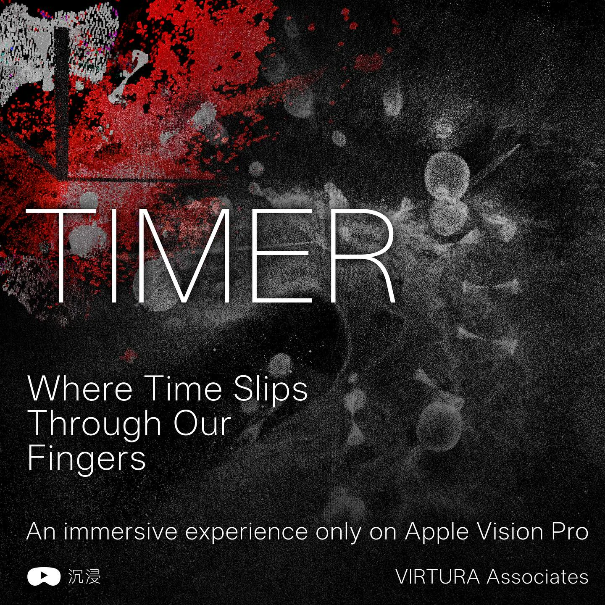

# TIMER — Volumetric / Spatial Study

## Public presentation / 公开展示

**TIMER — Spatial Study / 控时者·空间观看研究**  
延伸自 VIRTURA 2024 年合作视听作品《TIMER / 控时者》，由钱誉文继续进行体积化场景、Gaussian 场景归档与 Apple Vision Pro / XR 观看路径研究。此条目属于原作的空间媒介延伸，不能把它直接表述为已经正式展出的独立混合现实作品或完整交付的实时体积系统。

**TIMER — Spatial Study** extends the collaborative 2024 VIRTURA audiovisual work TIMER into volumetric scene exploration, Gaussian spatial archiving, and Apple Vision Pro / XR viewing pathways through Ewan Qian's subsequent individual studies. It is an evolving spatial-media research direction, not a claim that a standalone volumetric exhibition or complete live volumetric system has already been delivered.

### Current evidence / 现有材料

- 原始媒体资产：[featured-timer-visionpro.webp](../../assets/timer/featured-timer-visionpro.webp)；与个人仓库版本 SHA 相同，保留原图比例。
- 个人项目档案：[TIMER / 控时者](https://ewanqian.site/works/timer)；包含原作与 Gaussian 场景观看研究。
- 2024 年合作原作档案：[TIMER Series](./README.md)；团队署名必须保留。
- 2026 年研究方向：[Portfolio next works](https://github.com/ewanqian/portfolio/blob/main/docs/portfolio-maintenance-os/next-works-2026-2027.md) 记载 `TIMER — Volumetric Sand / 体积沙粒`，属于待推进方向，不得把规划当作完成成果。

### Proposed homepage treatment / 正式官网推荐展示

- **Placement**: Featured Research / Spatial Computing / XR；紧接实时音画系列之后的重点研究入口，不覆盖《TIMER》合作原作的演出档案。
- **Cover**: this full-aspect-ratio image; use `object-fit:contain` where needed, not forced crop.
- **Label**: `Spatial Computing / Research`，不可写 `Live Installation Delivered`。
- **Title**: `TIMER — Spatial Study` / `控时者 · 空间观看研究`。
- **CTA**: `查看空间研究 / Explore Spatial Study` → `https://ewanqian.site/works/timer`；等正式官网建立分离的研究页后替换成官网内链。
- **Credit**: `2024 Original: VIRTURA collaborative audiovisual work; Spatial archive / XR study: Ewan Qian.` 相关合作艺术家与原作的不同版本署名见原档案。
- **Status**: existing visual/scene research, ongoing; no asserted standalone public volumetric performance.

### What the website maintainer should NOT do

- 不把 2026 研究写成 2024 原作已实现的技术功能。
- 不把此图作为杭州双年展《滴流》的材料。
- 不在“精选商业交付”中把尚未完成的研究标记为 confirmed。
- 不删减原作的其他作者或把个人延伸研究归为 VIRTURA 团队已交付的商业项目。
